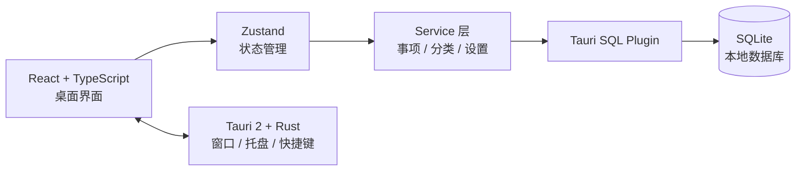

<div align="center">
  

  # 桌面便签

  **一款轻量、透明、待办存储在本地的 Windows 桌面工具。**

  随手记下，安静常驻，需要时一键呼出。

  <p>
    
    
    
    
    
  </p>
</div>

---

## 为什么用它

桌面便签把待办事项放在触手可及的位置，但不会变成另一个需要维护的复杂系统。按下全局快捷键即可呼出窗口，输入内容后按 `Enter` 完成记录；点击关闭按钮时，可选择退出应用或最小化到系统托盘。

- ⚡ **快速记录**：默认使用 `Ctrl + Alt + Space` 呼出，支持自定义快捷键
- 📌 **始终在手边**：窗口置顶、系统托盘和开机启动按需开启
- 🗂️ **清楚整理**：自定义分类、优先级、截止日期、置顶和拖拽排序
- 🎨 **融入桌面**：暖黄、浅色玻璃、深色玻璃三套主题，透明度自由调节；极简模式只保留事项标题
- 🔎 **专注当下**：按今天、已过期、未来事项、无日期或自定义类别筛选，并可按需在列表底部展开已完成事项
- 🔒 **本地优先**：事项、分类、设置和窗口状态均保存在本地 SQLite 数据库
- 📦 **数据可掌控**：通过 JSON 导入或导出全部事项与分类

## 功能一览

| 场景 | 支持能力 |
| --- | --- |
| 记录 | 快速输入、中文输入法兼容、详细备注 |
| 规划 | 分类、三级优先级、截止日期、时间范围筛选、可折叠的已完成事项 |
| 提醒 | 分钟级事项时间、提前提醒、Windows 原生通知、遗漏补检 |
| 重复 | 每天 / 工作日 / 每周 / 每月 / 每年 / 自定义间隔、结束条件、独立实例 |
| 整理 | 完成/恢复、置顶、同组拖拽排序、批量清空已完成 |
| 桌面体验 | 无边框透明窗口、始终置顶、窗口位置与尺寸记忆 |
| 快速访问 | 全局快捷键、系统托盘、开机启动、启动时隐藏 |
| 个性化 | 暖黄 / 浅色玻璃 / 深色玻璃主题、透明度调节、标题式极简模式 |
| 数据 | SQLite 本地存储、版本化迁移、JSON 导入导出 |

## 快速开始

### 环境要求

- Windows 10 / 11
- [Node.js](https://nodejs.org/) 20 或更高版本
- [Rust](https://www.rust-lang.org/tools/install) stable 工具链
- Microsoft Edge WebView2 Runtime（Windows 10/11 通常已预装）
- 使用 MSVC 的 Rust 构建环境时，需要 Visual Studio C++ Build Tools

### 本地运行

```powershell
git clone https://github.com/Zengweisong/desktop-sticky-notes.git
cd desktop-sticky-notes
npm ci
npm run tauri dev
```

首次启动时，应用会自动创建本地数据库并执行迁移，无需手动配置数据库。

### 构建 Windows 安装包

```powershell
npm run tauri build
```

NSIS 安装包默认生成在：

```text
src-tauri/target/release/bundle/nsis/
```

## 使用小贴士

1. 在其他应用中选中文字，按 `Ctrl + Alt + Space` 即可直接添加为事项并呼出窗口。没有选中文字时，若当前剪贴板文字在最近 3 秒内更新，则直接添加该文字；否则只呼出输入框。剪贴板以应用运行期间的更新为准，不读取 Windows 剪贴板历史，也不会覆盖剪贴板；图片和空文字会跳过。选区读取使用 Windows 辅助功能接口，读取失败时仍会尝试最近复制的文字。
   在设置中点击“快速呼出”，可录入组合键或 `Ctrl + Ctrl`（双击 Ctrl）：两次短按之间需要松开，第二次松开距第一次松开不超过 400 毫秒，每次按住不超过 300 毫秒。Ctrl+C 等组合键、长按和自动重复不会触发；原有快捷键在更改前继续保留。
2. 在顶部输入事项，按 `Enter` 添加；`Shift + Enter` 可换行。普通和极简模式都通过输入框下方的筛选菜单选择分类。新事项沿用所选分类；选择“全部分类”时，新事项归入“未分类”。
3. 点击输入框右侧的调节图标，可分别开启“提醒设置”和“重复设置”；两者互不依赖。
4. 点击事项即可查看并编辑备注、优先级、截止日期，也可选择只编辑本次或整个重复系列；开启极简模式后，列表、看板和日历只显示事项标题。
5. 拖动事项左侧手柄可调整顺序。为保持清晰，只能在置顶、未置顶或已完成的同一分组内排序。
6. 点击右上角关闭按钮（或按 `Alt + F4`），可选择“关闭应用”或“最小化到托盘”。最小化后提醒和重复检查继续运行，可用快捷键或托盘呼出；关闭应用后后台任务停止。设置和置顶可通过右上角按钮或托盘菜单调整。
7. 如需在 Windows 重启后自动恢复检查，请在设置中开启“开机自动启动”。
8. 点击标题栏的“AI 日报”，填入服务商的 OpenAI 兼容 API 地址、模型 ID 和密钥。保存后填写提示词并点击“发送”，即可汇总今天已完成事项并复制日报。

## 数据与隐私

### 对话同步（本地对话）

在“AI 日报”中配置 AI 服务后，打开“设置 → 对话同步 → 开启并连接本地对话”，再重启聊天客户端。应用会备份并更新当前用户的 `CODEX_HOME/hooks.json`（默认 `~/.codex/hooks.json`），安装 Windows PowerShell `Stop` Hook；已有的其他 Hook 会保留。需要客户端的 Hooks 功能保持启用。

每轮结束后，Hook 只收集该本地会话最近的用户与 AI 文本及项目工作目录，不读取系统提示词或工具调用参数。便签保持运行时，会在后台分析新增消息，创建具体事项、更新同一会话关联事项的标题、日期和待处理／进行中／已完成状态。新事项默认保存为“已完成”；用户明确要求待处理或进行中时按要求保存。新事项按 Codex 对话所在项目文件夹名自动创建或复用分类，无法获取目录时放入“未分类”；后续同步保留已有事项的分类及未明确变更的状态。已有事项改期时保留原提醒提前量；首次创建不会自动开启提醒。想法、假设和 AI 自称完成均要求模型忽略，应用还会校验新增用户消息中的原文依据，缺少有效依据的变更不会写入。

同步按轮次去重，并在 SQLite 事务中保存关联、变更与依据。分析期间被手动编辑的事项不会被覆盖；删除的关联事项不会按原关联自动恢复。“最近同步依据”可查看原文，“撤销上次同步”可撤销最近一批；如果事项后来又被修改，撤销会停止并提示原因。失败对话需点击“重试失败对话”，不会无限重复请求 AI。

升级到 0.7.0 后，若之前已开启对话同步，请关闭并重新开启一次，再重启 Codex，以更新本地采集脚本并启用项目分类。

**支持范围：** 此接入使用官方文档中的 Codex／本地 Work `Stop` 事件。客户端有 MCP 设置并不代表普通 ChatGPT Chat 也提供该事件，普通聊天目前尚未完成端到端兼容验证。Hook 只在启用同步后收集后续轮次，不回扫历史聊天。

**数据处理：** 对话同步默认关闭。开启后，本地受支持会话的用户和 AI 文字、关联事项会发送给你配置的 AI 服务，并产生额外调用。队列文本仅存放在本机应用配置目录 `chat-sync/queue`，成功处理后删除；失败文件保留供重试。关闭同步会清空待处理和失败文件，正在分析的结果也不会写入。同步历史保留事项变更及原文依据，不保存整段对话。启用后请按自己的使用习惯选择适合处理这些内容的 AI 服务。

验证 Windows Hook：`pwsh -NoProfile -File tests/chat-sync-hook.test.ps1`。该检查使用临时合成对话，不修改真实客户端配置或发送真实聊天。

待办数据由 Tauri SQL 插件保存在系统应用数据目录，日常使用无需账号或云服务。AI 日报是可选功能，只有点击生成时才会向你配置的服务发送所选日期及当日已完成事项的标题。API 配置和密钥保存在 Windows 凭据管理器。

升级应用时，数据库通过版本化 migration 自动演进。旧版 `notes.content` 会安全迁移为标题，旧事项会归入“未分类”，提醒默认关闭且不属于重复系列，不会通过删库重建来升级结构。

建议定期在“设置 → 导出数据”中生成 JSON 备份。第 3 版导出格式会同时保存事项实例、提醒状态和重复系列；仍可导入旧版备份。导入操作会校验数据格式，并在数据库事务中完成；失败时会自动回滚。

## 技术架构



| 层级 | 技术 | 职责 |
| --- | --- | --- |
| 界面 | React 18、TypeScript、Lucide | 交互、组件和图标 |
| 状态 | Zustand | 事项、分类和设置的前端状态 |
| 样式 | Tailwind CSS、原生 CSS | 主题、透明窗口与动效 |
| 桌面能力 | Tauri 2、Rust | 窗口、系统托盘、快捷键、开机启动 |
| 数据 | SQLite、Tauri SQL Plugin | 本地持久化、事务和结构迁移 |
| 工程 | Vite、Vitest | 开发构建与自动化测试 |

## 项目结构

```text
.
├─ src/
│  ├─ components/      # 界面组件
│  ├─ hooks/           # 业务 hooks
│  ├─ services/        # SQLite 数据访问与导入导出
│  ├─ stores/          # Zustand 状态
│  └─ types/           # TypeScript 类型
├─ src-tauri/
│  ├─ capabilities/    # Tauri 权限配置
│  ├─ src/             # Rust 桌面端与数据库迁移
│  └─ tauri.conf.json  # 窗口和安装包配置
└─ tests/              # 跨模块测试
```

## 开发命令

| 命令 | 用途 |
| --- | --- |
| `npm run tauri dev` | 启动完整桌面应用开发环境 |
| `npm run dev` | 仅启动 Vite 前端开发服务器 |
| `npm run build` | TypeScript 检查并构建前端 |
| `npm test` | 运行 Vitest 测试 |
| `npm run tauri build` | 构建 Windows NSIS 安装包 |

## 版本记录

每个版本的用户可见变更记录在 [CHANGELOG.md](CHANGELOG.md)。

## 参与开发

欢迎提交 Issue 或 Pull Request。开始修改前，请先确保以下检查通过：

```powershell
npm test
npm run build
```

如果修改了 Rust 桌面端代码，再执行：

```powershell
cargo test --manifest-path src-tauri/Cargo.toml
```

---

<div align="center">
  <sub>把事情记下来，然后继续做真正重要的事。</sub>
</div>
